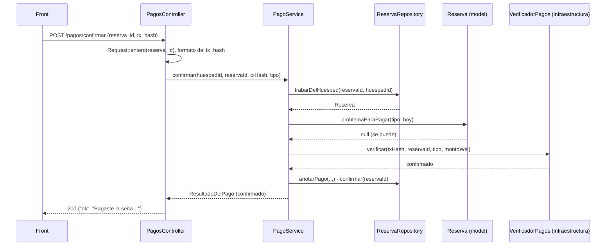

# Arquitectura del back: controllers, services, models y repository

**En una frase:** cada petición entra por un **controller**, que se la pasa a un **service**; el service resuelve el caso de uso apoyándose en los **models** (las reglas del negocio) y en los **repositories** (las consultas a la base). Cada capa tiene una sola responsabilidad y solo conoce a la de abajo.

Lo pidió el profesor en la revisión del 26/11. Es el patrón de capas que se usa en Spring, .NET, NestJS o Laravel bien organizado. La carpeta `repository/` ya existe: la abrió él con `UnidadRepository` y `ReservaRepository` (PR #60).

> Este documento dice **cómo queremos que quede**. Hoy gran parte del código está en el formato viejo (SQL y reglas adentro de los controllers, y `validacion/` con de todo). Se migra **de a un módulo por PR**, sin cambiar el comportamiento (ver [El plan de migración](#el-plan-de-migración)). **Todo lo nuevo se escribe con esta estructura.**

---

## Las capas

```
           petición HTTP
                │
        ┌───────▼────────┐
        │   controllers/  │  lee la petición, valida su FORMA, llama al service y responde
        └───────┬────────┘
                │
        ┌───────▼────────┐
        │    services/    │  resuelve UN caso de uso: transacción, pasos, servicios externos
        └──┬──────────┬──┘
           │          │
   ┌───────▼──┐  ┌────▼─────────┐
   │ models/  │  │ repository/  │  models: las reglas (sin base) · repository: el SQL
   └──────────┘  └──────────────┘
```

| Capa | Carpeta y namespace | Qué hace | Qué **no** hace |
|---|---|---|---|
| **Controller** | `controllers/` · `App\Controllers` | Exige el rol (`Autorizacion`), lee y valida la **forma** de los datos (`Request::entero`, `Request::datosJson`), llama a **un** método de un service y responde (`Respuesta::json` / `Respuesta::error`) | Reglas de negocio, SQL, transacciones, mails |
| **Service** | `services/` · `App\Services` | Coordina un caso de uso completo: abre la transacción, trae y traba filas con los repositories, le pregunta a los models qué corresponde, llama a lo externo (la red, los mails) y guarda | Saber de HTTP (`$_GET`, `$_SESSION`, códigos de respuesta) o escribir SQL |
| **Model** | `models/` · `App\Models` | Representa una cosa del negocio (una reserva, una liquidación) y **sabe sus reglas**: qué puede hacer y qué cuentas le corresponden | Tocar la base, la red o el reloj del sistema (la fecha de hoy se le pasa) |
| **Repository** | `repository/` · `App\Repository` | Las consultas SQL: buscar, trabar (`FOR UPDATE`), insertar y actualizar filas | Decidir: si una reserva se puede confirmar lo dice el model o el service, no el repository |

**La regla de oro (dependencias):** un controller usa services; un service usa models, repositories e infraestructura; un model no usa a nadie (es código puro); un repository solo usa la conexión. **Nunca al revés**: un repository no llama a un service, y un model no llama a un repository.

### Lo que no es ninguna de las cuatro capas

| Carpeta | Qué tiene | Por qué queda aparte |
|---|---|---|
| `mail/` | Los mails (`AvisoPagoMail`, `VerificacionMail`…) | Es infraestructura: el service los llama |
| `infraestructura/` (nueva) | Lo que habla con la blockchain: `ClienteRpc`, `FirmaEthereum`, los firmadores y verificadores (reales y simulados) | Es infraestructura: el service los recibe por el constructor, así en los tests se pasa el simulado |
| `validacion/` | Solo validadores de **formato** de datos (`ValidadorFechas`, `ValidadorDocumentos`, `DatosFiscales`) | Los usan controllers y services. Lo que hoy está acá y no valida se muda (ver [Dónde va lo que ya existe](#dónde-va-lo-que-ya-existe)) |
| `request/`, `autorizacion/`, `router/`, `database/`, `scripts/` | Como hasta ahora | `scripts/` (los cron) llama a services, igual que un controller |

---

## Cómo viaja una petición: pagar la seña



---

## El mismo código, antes y después

**Antes** (resumido): el controller hace todo.

```php
class PagosController
{
    public function confirmar()
    {
        Autorizacion::requiere('huesped');
        $datos = Request::datosJson();
        // ...validar el tx_hash...
        $pdo = Conexion::obtener();
        $pdo->beginTransaction();
        $consulta = $pdo->prepare('SELECT r.id, r.estado, ... FROM reservas r ... WHERE r.id = ? AND r.huesped_id = ? FOR UPDATE');
        $consulta->execute([$datos['reserva_id'], $_SESSION['usuario']['id']]);
        $reserva = $consulta->fetch();
        if ($reserva['estado'] === 'pendiente' && $reserva['bloqueo_expira_en'] < $ahora) { /* regla de negocio */ }
        // ...verificar en la red, INSERT INTO pagos, UPDATE reservas, mandar el mail...
        $pdo->commit();
        http_response_code(200);
        echo json_encode(['ok' => 'Pagaste la seña']);
    }
}
```

**Después:** cada capa hace lo suyo.

```php
//controllers/PagosController.php — solo HTTP
class PagosController
{
    public function confirmar()
    {
        Autorizacion::requiere('huesped');
        $datos = Request::datosJson();
        $reservaId = Request::entero($datos['reserva_id'] ?? null);
        $txHash = Request::hashDeTransaccion($datos['tx_hash'] ?? null);
        if ($reservaId === null || $txHash === null) {
            return Respuesta::error('El pago no es válido');
        }

        $resultado = (new PagoService())->confirmar((int) $_SESSION['usuario']['id'], $reservaId, $txHash, $datos['tipo'] ?? null);

        Respuesta::json($resultado->cuerpo(), $resultado->codigo());
    }
}

//services/PagoService.php — los pasos del caso de uso
class PagoService
{
    //Las dependencias externas entran por el constructor: en los tests se pasa el verificador simulado
    public function __construct(private ?VerificadorPagos $verificador = null)
    {
        $this->verificador ??= Verificadores::configurado();
    }

    public function confirmar(int $huespedId, int $reservaId, string $txHash, ?string $tipo): ResultadoDelPago
    {
        return Conexion::enTransaccion(function () use ($huespedId, $reservaId, $txHash, $tipo) {
            $reserva = ReservaRepository::trabarDelHuesped($reservaId, $huespedId)
                ?? throw new ErrorDeNegocio('No encontramos esa reserva', 404);
            $tipo ??= $reserva->tipoDePagoQueSigue();
            $reserva->asegurarQueSePuedePagar($tipo, ValidadorFechas::hoy());   //la regla está en el model
            $verificacion = $this->verificador->verificar($txHash, $reservaId, $tipo, $reserva->montoWei($tipo));
            PagoRepository::anotar($reserva, $tipo, $txHash, $verificacion);
            if ($verificacion->confirmado()) {
                ReservaRepository::marcarPagada($reserva, $tipo);
                AvisoPagoMail::pagoConfirmado($reserva, $tipo);
            }
            return ResultadoDelPago::desde($verificacion, $tipo);
        });
    }
}

//models/Reserva.php — las reglas, sin base ni red
final class Reserva
{
    public function __construct(
        public readonly int $id,
        public readonly string $estado,
        public readonly ?string $bloqueoExpiraEn,
        public readonly string $importeSena,
        public readonly ?string $montoFaltante,
        //...
    ) {}

    //Por qué no se puede pagar (ErrorDeNegocio con su mensaje y su código), o nada si se puede
    public function asegurarQueSePuedePagar(string $tipo, \DateTimeImmutable $hoy): void { /* ... */ }
}

//repository/ReservaRepository.php — el SQL
class ReservaRepository
{
    public static function trabarDelHuesped(int $id, int $huespedId): ?Reserva
    {
        $consulta = Conexion::obtener()->prepare('SELECT ... FROM reservas WHERE id = ? AND huesped_id = ? FOR UPDATE');
        $consulta->execute([$id, $huespedId]);
        $fila = $consulta->fetch();
        return $fila === false ? null : Reserva::desdeFila($fila);
    }
}
```

> El ejemplo muestra **la forma**, no el código final: los nombres exactos se deciden al migrar cada módulo.

---

## Convenciones

| Tema | Cómo |
|---|---|
| **Nombres** | `XController`, `XService` (por funcionalidad: `PagoService`, `ReservaService`, `LiquidacionService`), `XRepository` (por tabla o agregado, como los del profe), models con el nombre de la cosa (`Reserva`, `Liquidacion`, `Unidad`) |
| **Repositories** | Métodos **estáticos**, como los que hizo el profe (`ReservaRepository::confirmar($id)`). Devuelven models (o `null` si no hay fila), no arrays de PDO |
| **Services** | **Instancias**, con las dependencias externas por el constructor (verificador, firmador, enviador de mails), con el real por defecto. Así un test puede pasar el simulado sin base de datos |
| **Models** | Clases con propiedades `readonly` y métodos con las reglas. Se arman desde una fila con `Modelo::desdeFila($fila)`. Las fechas ("hoy", "ahora") se les pasan, no las calculan |
| **Errores del negocio** | El service o el model lanzan `ErrorDeNegocio($mensaje, $codigo)` (en `exceptions/`). El router lo atrapa y responde con `Respuesta::error`, igual que hoy con `DatosInvalidosException`. Así no hay que devolver `['error' => …]` y chequearlo en cada capa |
| **Transacciones** | Solo en el service, con `Conexion::enTransaccion(fn () => …)`: si algo lanza una excepción, vuelve atrás sola |
| **Respuestas HTTP** | Solo en el controller (`Respuesta::json` / `Respuesta::error`). El service devuelve datos o un objeto de resultado |
| **Datos de la petición** | Solo en el controller: `Request::entero`, `Request::enteroDeLaUrl`, `Request::datosJson`, `$_SESSION`. Al service le llegan valores ya validados (`int $reservaId`, no `$_GET['id']`) |
| **Comentarios** | Como siempre: cada archivo y cada función con un comentario breve de su objetivo |

---

## Cómo se prueba cada capa

| Capa | Tipo de test | Ejemplo |
|---|---|---|
| Model | **Unitario**, sin base: rápido y exacto | `tests/Unitarios/ReservaTest.php`: una pendiente vencida no se puede pagar |
| Service | Unitario con dependencias simuladas, o de integración | `PagoService` con `VerificadorSimulado` |
| Repository y controller | **Integración** (los de `tests/Integracion/`, contra la base de prueba) | Los que ya existen: no cambian al migrar, y son la red de seguridad |

Al migrar un módulo **no se tocan los tests de integración**: tienen que seguir pasando igual. Si una respuesta cambia, el refactor cambió el comportamiento.

---

## Dónde va lo que ya existe

| Hoy | Va a | Por qué |
|---|---|---|
| `validacion/Liquidacion.php` (`calcular`, `repartirWei`, `faltante`) | `models/Liquidacion.php` | Son reglas puras |
| `validacion/Devolucion.php`, `Estadia.php` (la cuenta), `Descuentos.php`, `PlazoIngreso.php`, `VencimientoReserva.php` (las reglas) | `models/` | Reglas del negocio |
| `validacion/Estadisticas.php` (`calcular`) | `models/Estadisticas.php` (la consulta, a un repository) | Cuenta pura más una consulta |
| `validacion/PagoDeLiquidacion.php`, `CancelacionConDevolucion.php`, `ReservaGrupal.php` (`crear`), `NuevaReserva.php`, `Extension.php`, `NoShow.php`, `CobroDelSaldo.php`, `RegistroPendiente.php`, `ExcepcionDeCancelacion.php` | `services/` (sus consultas, a `repository/`) | Coordinan casos de uso |
| `validacion/UnidadGrupal.php` (`armar`, `validar`) | `models/` (reglas) + `repository/` (consultas) | Mezcla las dos cosas |
| `validacion/ClienteRpc.php`, `FirmaEthereum.php`, `Firmador*.php`, `Verificador*.php`, `EnvioTransaccion.php`, `ResultadoVerificacion.php`, `TipoDeCambio.php` | `infraestructura/blockchain/` | Hablan con la red |
| `validacion/ValidadorFechas.php`, `ValidadorDocumentos.php`, `DatosFiscales.php` (la validación), `Ubicacion.php`, `ReglasPublicacion.php` | Se quedan en `validacion/` (o su parte de consultas va a un repository) | Validan formato |
| `validacion/ReservasSimuladas.php`, `ReservasDePrueba.php` | `repository/` | Son consultas de mantenimiento |
| El SQL de los controllers | `repository/` | — |

---

## El plan de migración

De a un módulo por PR, sin cambios de comportamiento, con la suite completa y los E2E en verde en cada paso.

| Orden | Módulo | Qué incluye | Por qué en este orden |
|---|---|---|---|
| 0 | **Base** | `services/`, `models/`, `infraestructura/` en `composer.json`; `ErrorDeNegocio` atrapado en el router; `Conexion::enTransaccion`; este documento | Lo que necesitan todos los demás |
| 1 | **Pagos y reservas** | `PagosController`, `ReservasController`, `ReservasGrupalesController` → `PagoService`, `ReservaService`, `ReservaGrupalService`; model `Reserva`; `ReservaRepository`, `PagoRepository` | Es el módulo más grande y el que más mezcla; ya tiene los repositories del profe y el refactor de Agustina (#57) |
| 2 | **Cancelaciones y liquidaciones** | `CancelacionConDevolucion`, `Devolucion`, `PagoDeLiquidacion`, `Liquidacion`, `LiquidacionesController` | Dependen de reservas y pagos |
| 3 | **Unidades** | Unidades, fotos, temporadas, precios, bloqueos, descuentos, publicación, unidades grupales | Mucho SQL en controllers, poca regla |
| 4 | **Cuentas** | Registro, sesión, OAuth, verificación de mail, recuperación, backoffice | Lo que menos cambia |
| 5 | **Infraestructura** | Mover blockchain de `validacion/` a `infraestructura/blockchain/` | Solo cambia namespaces |

**Para el equipo, mientras tanto:** lo nuevo (modificar fechas, estadísticas, iCal, check-out) se escribe directamente con service + model + repository. Antes de abrir un PR que toque un módulo que se está migrando, conviene avisar en el grupo para no pisarse.

---

## Checklist para un PR

- [ ] El controller no tiene SQL, ni reglas, ni transacciones.
- [ ] El service no lee `$_GET`/`$_SESSION` ni responde HTTP.
- [ ] El model no toca la base ni calcula "hoy" por su cuenta.
- [ ] El repository no decide nada.
- [ ] Los tests de integración pasan sin tocarlos; las reglas nuevas tienen tests unitarios del model.
- [ ] Cada archivo y cada función tienen su comentario.
